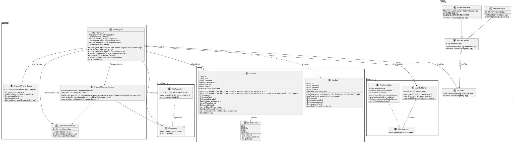

# 🛡️ Cybersecurity SIEM (Security Information and Event Management) System

Bu proje, nesne yönelimli programlama (OOP), tasarım desenleri (Design Patterns) ve veri yapıları kullanılarak geliştirilmiş modüler bir **Siber Güvenlik Olay Yönetimi (SIEM) Kural Motorudur**.

Sistem, ham log verilerini güvenlik filtrelerinden geçirerek olası tehditleri tespit etmeyi, güvenlik olaylarını tehdit seviyelerine göre önceliklendirmeyi, kritik olaylar için bildirim üretmeyi ve olay kayıtlarını kalıcı olarak saklamayı amaçlar.

---

## 🏗️ Mimari ve Tasarım Desenleri

### 1. Chain of Responsibility (Sorumluluk Zinciri)

**Amaç:** Gelen log kayıtlarını birbirinden bağımsız güvenlik filtrelerinden geçirmek.

**Uygulama:** `AbstractLogFilter` sınıfından türeyen `BruteForceFilter` ve `IpBlacklistFilter` sınıfları kullanılır.

- **BruteForceFilter:** Belirlenen zaman aralığında aynı IP adresinden gelen başarısız giriş denemelerini takip eder. Eşik değerine ulaşıldığında yüksek seviyeli (HIGH) bir güvenlik olayı oluşturur.
- **IpBlacklistFilter:** Kara listede bulunan IP adresleriyle ilişkili aktiviteleri kontrol ederek yüksek öncelikli olay oluşturur.

Filtrelerin sırası ve birden fazla kuralın eşleşmesi durumunda uygulanacak öncelik mantığı, olayların doğru sınıflandırılmasını sağlamak amacıyla belirlenmiştir.

### 2. Observer Pattern (Gözlemci Deseni)

**Amaç:** Güvenlik olayları oluştuğunda ilgili analistlere bildirim gönderilmesini sağlamak.

**Uygulama:** `AlertPublisher`, olay bildirimlerini abonelere ileten bileşendir. `AnalystNotifier` ise bildirimleri alan gözlemci olarak görev yapar.

### 3. Veri Kalıcılığı (Data Persistence)

**Amaç:** Uygulama yeniden başlatıldığında güvenlik olaylarının ve durum bilgilerinin korunması.

**Uygulama:** `SIEMEngine` ile `FileRepository` arasındaki iş birliği sayesinde olaylar dosyaya kaydedilir ve yeniden yüklenir. Aktif ve çözümlenmiş olaylar, durumlarına uygun biçimde yönetilir.

---
## 🧩 SOLID Prensipleri

Projenin modüler, genişletilebilir ve bakımı kolay bir yapıda olması amacıyla SOLID prensiplerinden yararlanılmıştır.

### 1. Single Responsibility Principle (SRP) – Tek Sorumluluk Prensibi

Sınıflar belirli görevleri yerine getirecek şekilde tasarlanmıştır. `BruteForceFilter` başarısız giriş denemelerini analiz ederek brute-force saldırılarını tespit ederken, `FileRepository` olay kayıtlarının dosyaya yazılması ve dosyadan okunmasından sorumludur. `AnalystNotifier` ise olay bildirimlerini alır.

### 2. Open/Closed Principle (OCP) – Gelişime Açık, Değişikliğe Kapalı Olma

`LogFilter` arayüzü ve `AbstractLogFilter` soyut sınıfı, filtreleme sisteminin genişletilmesini kolaylaştırır. Yeni bir güvenlik filtresi eklenerek mevcut filtrelerin kodunu değiştirmeden yeni tehdit tespit kuralları sisteme dahil edilebilir.

### 3. Liskov Substitution Principle (LSP) – Liskov Yerine Geçme Prensibi

`BruteForceFilter` ve `IpBlacklistFilter`, ortak filtre sözleşmesini uygulayarak filtre zincirinde kullanılabilecek şekilde tasarlanmıştır. Bu yaklaşım, filtrelerin beklenen `LogFilter` davranışına uygun olmasını hedefler.

### 4. Dependency Inversion Principle (DIP) – Bağımlılıkların Tersine Çevrilmesi

`SIEMEngine`, doğrudan `FileRepository` sınıfına bağımlı olmak yerine `IRepository<Incident>` arayüzünü kullanır. Böylece veri saklama yöntemi değiştirildiğinde, arayüze uygun yeni bir repository uygulaması kullanılarak motorun somut veri saklama sınıfından bağımsız kalması sağlanır.

## 📊 Veri Yapıları

- **PriorityQueue:** Güvenlik olaylarını tehdit skorlarına göre önceliklendirmek için kullanılır. Kuyruğun doğru sıralanması, kullanılan karşılaştırma kuralına bağlıdır.
- **HashMap ve List:** Brute force tespitinde IP adreslerine ait başarısız giriş zamanlarını takip etmek ve belirlenen zaman penceresindeki denemeleri değerlendirmek için kullanılır.

## UML Sınıf Diyagramı

Aşağıdaki UML sınıf diyagramı, sistemin mimarisini; temel sınıfları, arayüzleri, kalıtım ilişkilerini ve kullanılan tasarım kalıplarını göstermektedir.

Diyagramın düzenlenebilir PlantUML kaynak dosyasına [`src/UML_Diagram.puml`](src/UML_Diagram.puml) üzerinden ulaşılabilir.

